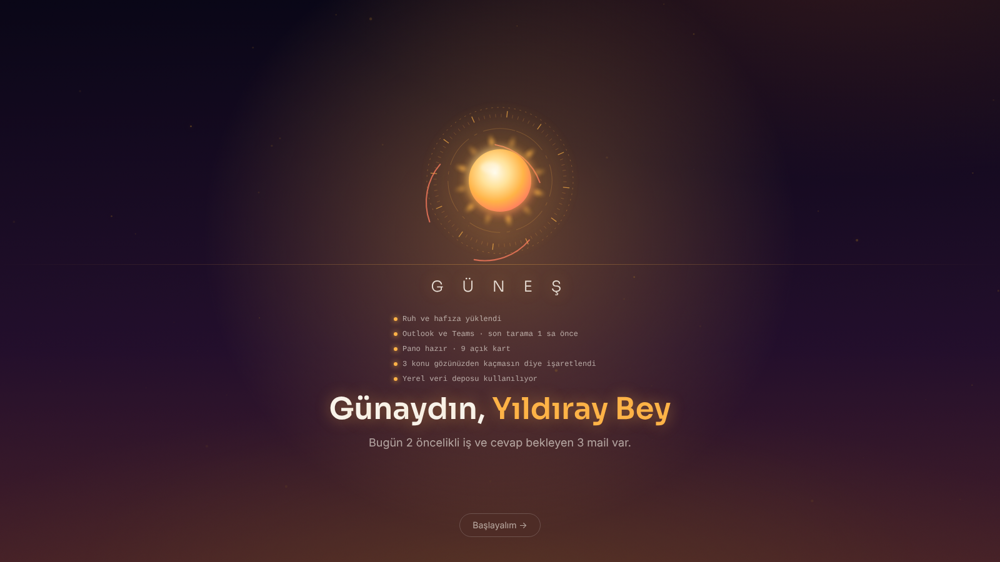
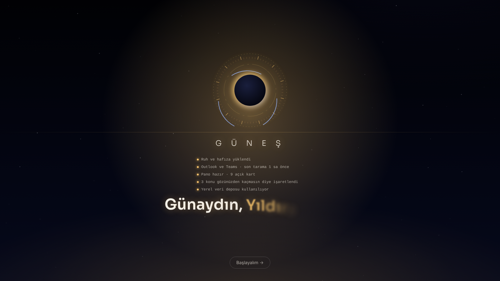
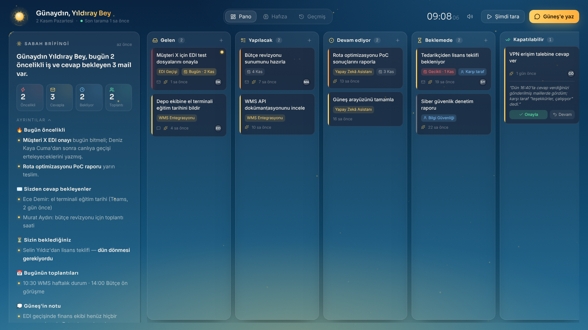
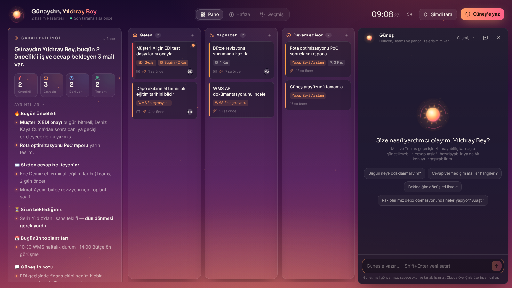

# ☀️ Güneş

Outlook ve Teams'inizi takip eden, işleri kanban panosunda düzenleyen, hafızası olan kişisel asistan.
Her sabah sizi karşılar, gün içinde 2 saatte bir gelişmeleri kontrol eder, gözden kaçanları hatırlatır ve sohbet edebilir.

**API anahtarı kullanmaz.** Bilgisayarınızdaki resmi `claude` CLI'ını (Claude Code) çalıştırır, yani her şey Claude Pro üyeliğiniz üzerinden işler. Outlook ve Teams'e claude.ai'de bağladığınız Microsoft 365 connector'ı ile erişir.

| Sabah karşılaması | Gece (tutulma) |
|---|---|
|  |  |
| **Pano** | **Sohbet** |
|  |  |

> Ekran görüntülerindeki kişi ve işler `npm run demo` ile yüklenen örnek verilerdir.

---

## Nasıl çalışır?

```
Windows açılışı
 └─ Güneş sunucusu (arka planda, sadece bu bilgisayardan erişilir: 127.0.0.1:4317)
     ├─ Zamanlayıcı ─ 08:30 sabah çalışması (bilgisayar kapalıysa açılınca telafi eder)
     │              └ mesai içinde 2 saatte bir takip (yeni bir şey yoksa planlayıcıyı çalıştırmaz)
     │
     │   ① Toplayıcı (Haiku)   Outlook + Teams + Takvim'i okur → olayları kaydeder
     │   ② Planlayıcı (Sonnet) kart açar/günceller, öneri bırakır, brifing + günlük yazar
     │   ③ Bildirici (Haiku)   sabah özetini Teams'te size gönderir (isteğe bağlı)
     │
     ├─ Sohbet köprüsü ─ arayüz ↔ claude CLI (canlı akış, oturum hafızası)
     └─ Arayüz ─ Karşılama · Brifing · Kanban · Hafıza · Geçmiş · Sohbet
                 │
Supabase  ◄──────┘  kartlar, olaylar, öneriler, brifingler, hafıza (versiyonlu), sohbetler
```

Claude panoya ve hafızaya yalnızca **Güneş MCP aracı** (`server/src/mcp.ts`) üzerinden yazar. Her yazma şema ile doğrulanır ve güvenlik kuralları kodda uygulanır:

- Güneş **mail/mesaj göndermez, silmez, takvime dokunmaz.** Sohbette istenirse sadece cevap **taslağı** hazırlar.
- Güneş bir kartı **"Bitti"ye taşıyamaz**; en fazla gerekçesiyle **"Kapatılabilir"e** koyar, onay sizindir.
- Ruhun çekirdeği (kişilik ve güvenlik kuralları) veritabanında **kilitlidir**; Güneş değiştiremez.

## Kurulum (Windows)

### 0. Ön koşullar
- [Node.js LTS](https://nodejs.org) (20 veya üstü)
- [Claude Code](https://code.claude.com). Kurduktan sonra bir terminalde `claude` yazın ve **claude.ai hesabınızla** giriş yapın.
- claude.ai → Ayarlar → Connectors'ta **Microsoft 365** bağlı olmalı.

### 1. Supabase
1. [supabase.com](https://supabase.com)'da proje açın.
2. **SQL Editor**'ü açın, `supabase/migrations/0001_init.sql` dosyasının içeriğini yapıştırın ve **Run**'a basın.
3. **Project Settings → API**'den `Project URL` ve `service_role` anahtarını alın. Bunları bir sonraki adımda `.env` dosyasına yazacaksınız. Anahtarı kimseyle paylaşmayın, sohbete de yapıştırmayın.

> Supabase'i atlarsanız Güneş yerel dosya modunda (`data/local-db.json`) çalışır. Bu mod denemek için uygundur.

### 2. Güneş'i kurun
```bash
git clone https://github.com/BenYILDO/gunes_ai_assistant.git
```
```bash
cd gunes_ai_assistant
```
```bash
powershell -ExecutionPolicy Bypass -File scripts\windows\setup.ps1
```
Kurulum betiği şunları yapar: paketleri kurar, derler, `.env` dosyasını oluşturup Not Defteri'nde açar (Supabase bilgilerini buraya girin), canlı kontrol yapar ve isterseniz Güneş'i Windows açılışına ekler.

### 3. Kontrol
```bash
npm run doctor -- --live
```
Bu komut Claude CLI'ı, Supabase'i, Güneş MCP aracını ve Microsoft 365 connector'ını dener. Connector'ın adı farklı çıkarsa, hangi satırı `.env`'ye yazmanız gerektiğini söyler.

### 4. İlk çalışma
Masaüstündeki **Güneş** kısayoluna tıklayın, sonra panodaki **"Geçmişi tara"** butonuna basın. Güneş son 45 günü 7 günlük parçalar halinde tarayıp panoyu ve hafızasını kurar. Bu işlem ilk seferde uzun sürer ve Pro limitinizden yer; gerekirse `GUNES_BACKFILL_DAYS` değerini düşürebilirsiniz.

## Günlük kullanım

| Ne zaman | Ne olur |
|---|---|
| Bilgisayar açılınca | Sunucu arka planda başlar, Güneş penceresi açılır, günün ilk açılışında karşılama animasyonu oynar |
| 08:30 (ya da açılışta, kaçırıldıysa) | Sabah çalışması: son 24 saat taranır, brifing yazılır, Teams'e özet gider |
| Mesai içinde 2 saatte bir | Takip: yeni gelişme varsa kartlar güncellenir, öneriler eklenir |
| Her an | **Güneş'e yaz** ile sohbet. Kart açtırabilir, mail aratabilir, taslak hazırlatabilir, araştırma yaptırabilirsiniz |

**Geri bildirim Güneş'i eğitir:**
- Bir öneride "Bilerek yaptım" → aynı şeyi bir daha sormaz.
- Güneş'in açtığı bir kartta "Gereksizdi — Güneş öğrensin" → bu tür kartları açmaz.
- "Kapatılabilir"deki bir kartı geri alırsanız → bir dahakine daha temkinli olur.
- Hafıza ekranında "Bir şey öğret" → kalıcı bilgi ekleyebilirsiniz.

## Claude Code oturumlarından panoyu güncellemek

Bu repoda açtığınız Claude Code oturumları, `.mcp.json` sayesinde Güneş araçlarını otomatik görür. **Tüm projelerinizde** kullanmak için (örneğin bir projede iş bitince kartı güncelletmek) Güneş'i kullanıcı seviyesinde ekleyin:

```bash
claude mcp add --scope user gunes -- node C:\yol\gunes_ai_assistant\server\dist\mcp.js
```

Sonra herhangi bir projede *"Güneş panosunda X kartına ilerleme notu düş"* demeniz yeterli.

## Komutlar

| Komut | Açıklama |
|---|---|
| `npm start` | Sunucuyu başlatır (http://localhost:4317) |
| `npm run dev` | Geliştirme modu (arayüz: http://localhost:5317) |
| `npm run build` | Sunucu + arayüz derler |
| `npm run doctor -- --live` | Kurulum kontrolü |
| `npm run run:morning` / `run:tracker` / `run:backfill` | Ajanları elle çalıştırır |
| `npm run demo` | Yerel modda örnek veri yükler (arayüzü denemek için) |
| `scripts\windows\stop-gunes.ps1` | Sunucuyu durdurur |
| `scripts\windows\uninstall-autostart.ps1` | Açılıştan kaldırır |

Arayüz adresine eklenebilen parametreler: `?intro=1` karşılamayı zorla oynatır, `?phase=night` (`dawn|day|dusk|night`) temayı önizler.

## Maliyet ve limitler (Pro)

- Tarama işleri **Haiku**, planlama ve sohbet **Sonnet** ile yapılır (`.env` dosyasından değiştirilebilir).
- 2 saatlik takipte yeni olay yoksa planlayıcı hiç çalışmaz.
- Hepsi aynı Pro limitini paylaşır; limite takılırsanız önce `GUNES_TRACKER_EVERY_HOURS` değerini artırın.

## Sorun giderme

- **Microsoft 365 araçları görünmüyor:** Claude Code'a claude.ai hesabıyla giriş yaptığınızdan ve connector'ın claude.ai'de bağlı olduğundan emin olun. Sonra `npm run doctor -- --live` çalıştırın.
- **`claude` bulunamadı:** `.env` dosyasında `CLAUDE_BIN` değerine tam yolu yazın (örn. `C:\Users\<siz>\.local\bin\claude.exe`).
- **Sesli karşılama yok:** Edge zaten açıksa ses izni bayrağı uygulanmaz; başlıktaki hoparlör ikonundan sesi açıp kapatabilirsiniz. Windows'ta doğal Türkçe ses için Ayarlar → Zaman ve dil → Konuşma'dan "Microsoft Emel" sesini ekleyin.
- **Loglar:** `data\gunes.log`

## Yol haritası

- **Faz 1 (bu sürüm):** Toplayıcı, planlayıcı, takipçi, sohbet, temel hafıza, kanban, karşılama
- **Faz 2:** Önem puanlı hafıza sıkıştırma, haftalık iç gözlem ve "seni tanıdım" kartı
- **Faz 3:** Araştırmacı Güneş (rakip ve sektör radarı: GitHub, Reddit, HN, sektör siteleri)
- **Faz 4:** Claude Code oturumlarından otomatik proje ilerleme takibi
